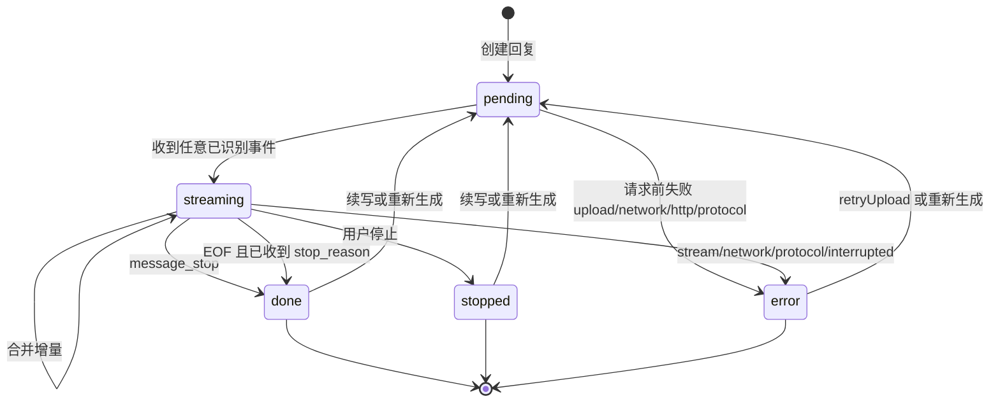

# API 协议与流式客户端契约

票：`05-api-protocol`。本文是规格的 `api.md` 章节草案，类型与状态机可直接转为 Dart 实现。

- 行为来源：`~/ZoneCode/chat-demo`（下文标注文件与行号）。
- 数据模型与持久化：见票 06；界面：见票 10；附件上传细节：见票 13；内容安全提示：见票 14；引用展示：见票 12；用户元信息取值：见票 16。
- API 文档：<https://api-docs.deepseek.com/zh-cn/api/create-message>。

## 1. 端点、鉴权与基址

| 用途 | 方法与路径 | 鉴权 |
| --- | --- | --- |
| 校验 Key、模型列表 | `GET {origin}/models` | `Authorization: Bearer {key}` |
| 消息 | `POST {origin}/anthropic/v1/messages` | `x-api-key: {key}` |
| 上传附件 | `POST {origin}/anthropic/v1/files` | `x-api-key` + `anthropic-beta` |
| 删除附件 | `DELETE {origin}/anthropic/v1/files/{file_id}` | `x-api-key` + `anthropic-beta` |

- 默认 `origin = https://api.deepseek.com`，构建时可覆盖（chat-demo 用构建期注入，Flutter 建议 `--dart-define`，最终由票 07 定）。
- 消息请求头：`Content-Type: application/json`、`Accept: text/event-stream`、`x-api-key`。
- 请求体含 `image` / `document` 文件块，或调用 Files API 时，追加 `anthropic-beta: files-api-2025-04-14`（`client.ts:17,85-90,133-138`）。
- 消息请求体由传输层追加 `"stream": true`；`CreateMessageRequest` 类型不含该字段（`client.ts:156`）。
- **模型**：v1 固定 `deepseek-flash`，无模型选择器；`deepseek-v4-pro` 只保留在类型联合中供后续扩展（`store.ts:36`、`api/types.ts:7`）。`GET /models` 只用于校验 Key 是否有效，不解析模型列表（`client.ts:92-99`、`useApiKeyForm.ts:7,38`）。

## 2. 请求体

```ts
type CreateMessageRequest = {
  model: 'deepseek-flash' | 'deepseek-v4-pro'   // v1 恒为 deepseek-flash
  system: string                                  // 恒为固定文案，见下
  messages: MessageParam[]
  thinking: { type: 'enabled' | 'disabled' }
  tools: Array<
    | { type: 'deepseek_read_url'; name: 'deepseek_read_url' }
    | { type: 'deepseek_web_search'; name: 'deepseek_web_search' }
  >
  safety_check: { level: 'high' }                 // 恒开启
  title?: { enabled: true }                       // 仅未命名会话的请求携带
}
```

- `system` 固定：`该助手为DeepSeek，由深度求索公司创造。`（`store.ts:38`）。
- `thinking`：由本轮回复创建时的开关快照决定；历史/续写沿用该回复的 `thinking`，未记录时用当前设置（`store.ts:258-265,708-714,1005`）。
- `tools`：`deepseek_read_url` 恒声明；`deepseek_web_search` 仅当本轮 `search` 快照为 true 时追加（`store.ts:48-57,1007`）。
- `safety_check`：所有请求恒为 `{ level: 'high' }`，所有流量走扩展模式（`store.ts:42,1006`）。
- `title`：仅当会话标题为空且本轮请求被允许自动补标题时携带（见 §7）。
- `model`：新回复取当前默认模型；续写取回复记录的模型，缺省回退默认（`store.ts:263,712,1002`）。
- `latest_reminder`：`messages` 中的扩展角色，见 §3.3。

## 3. 消息构造

### 3.1 上下文轮次

只回传「提问 + 可用回答」成对的轮次，末尾接本轮提问；续写再追加 assistant 前缀（`reply.ts:286-343`）。

可用回答（`reply.ts:197-202`）同时满足：

1. `status` 为 `done` 或 `stopped`；
2. `stopReason != 'refusal'`；
3. 不含 `isTemplate` 文本块；
4. 拼接后的文本非空。

失败、被停止后无文本、未完成、被安全拒绝的轮次都不进入上下文。

### 3.2 user 消息

- 有文件时 `content` 为数组：先文件块、后文本块；无文件时为纯字符串（`reply.ts:205-213`）。
- 图片用 `{ type: 'image', source: { type: 'file', file_id } }`，其余用 `document`（`reply.ts:22-32`）。
- `serverId` 为 null 的附件不进入请求；本地也没有原件时只展示（`reply.ts:20-21`，`store.ts:775-792`）。
- 历史提问无文字且无可用文件块时，整个轮次连同回答省略（`reply.ts:319-322`）。

### 3.3 latest_reminder

- 角色：`{ role: 'latest_reminder', content: string }`，位于对应 user 消息之前（`api/types.ts:156-161`）。
- 快照在附件补齐成功后生成本轮值；续写沿用原回复快照（`store.ts:985-989`）。
- 插入规则：仅在当前分支首次出现或内容与上一条快照不同时插入；历史消息缺快照则不插（`reply.ts:311-327`）。
- 内容五项：日期、星期、所在地、平台、语言，逗号连接（`latestReminder.ts:18-30`）。具体取值与平台标记（Web → iOS/Android）由票 16 锁定；本票只锁定角色与插入语义。

### 3.4 assistant 历史消息

按块顺序转换，规则来自 `reply.ts:223-284`：

1. **思考块**：历史轮次一律不回传；仅续写前缀且本轮 `thinking=true` 时保留非空白思考及其 `signature`。
2. **文本块**：去掉 `citations`（服务端忽略）。相邻文本块直接拼接；被「不回传的块」（历史思考、非 read_link 工具等）隔开的文本块用 `\n\n` 连接；若前一个保留块是工具块，则新文本块不加前缀。省略思考后仍保留其前后正文的空行语义（`reply.ts:240-259`）。
3. **工具块**：只回传 `kind == 'read_link'` 的 `server_tool_use` 与其 `web_fetch_tool_result`；其余工具调用和结果一律不回传。
4. **阅读链接签名**：成功的 `read_link` 结果原样回传，保留 `signature`，供服务端解密恢复网页上下文；成功结果缺少非空 `signature` 时，对应的调用与结果**都**丢弃；结果缺失的孤立调用照常回传（`reply.ts:229-239,266-278`）。
5. **模板文本**：`isTemplate` 块不进入上下文，含模板块的轮次按 §3.1 排除。
6. **空文本**：过滤 `text == ''` 的文本块。

### 3.5 分支与请求

- 展示与请求上下文共用「当前选中分支」的可见消息路径（`branches.ts:17-35`）。
- 重新生成：在原问题下新增 assistant 版本，历史为问题之前的部分，不覆盖旧回答（`store.ts:618-642`）。
- 编辑提问：新增同父 user 版本并复用原附件，历史上溯到该问题之前（`store.ts:644-680`）。
- 这些操作的持久化结构由票 06 锁定，API 侧只要求「请求拿到的 history 是可见路径的前缀」。

## 4. SSE 协议

端点以 `text/event-stream` 响应，事件名与 JSON 的 `type` 相同，以 `message_stop` 结束，**不发送 `[DONE]`**（`api/types.ts:212-234`）。

### 4.1 事件全集

| 事件 | 关键字段 | 合并语义 |
| --- | --- | --- |
| `message_start` | `message.id`、`message.model`、`usage?` | 记录 usage；进入 streaming（`reply.ts:78-83`） |
| `content_block_start` | `index`、`content_block` | 建立「服务端 index → 本地块下标」映射并追加块；无法识别的块不占位；`tool_use` 块丢弃并把 `prefix` 置 false（`reply.ts:84-92`） |
| `content_block_delta` | `index`、`delta` | 按映射追加：`text_delta`、`thinking_delta`、`signature_delta`（字符串拼接）、`citations_delta`（追加引用）；未知 index 忽略；`input_json_delta` 不消费（`reply.ts:93-114`） |
| `content_block_stop` | `index` | 删除映射；思考块写 `endedAt`（`reply.ts:115-126`） |
| `message_delta` | `delta.stop_reason`、`stop_details?`、`delta.title?`、`usage?` | 更新结束原因、拒绝详情、累计 usage；处理自动标题（§7）（`reply.ts:127-133`、`store.ts:1013-1026`） |
| `message_stop` | 无 | 正常结束（`client.ts:183-185`） |
| `ping` | 无 | 忽略（`parseEvent.ts:227-229`） |
| 错误帧 | 无名 data 或 `event: error`，JSON 含 `error` | 抛 `stream` 错误，连接随后关闭（`client.ts:172-177`） |

无法识别或无法安全消费的事件静默丢弃，不影响后续内容（`parseEvent.ts:174-231`）。

### 4.2 内容块

- **text**：`text`、可选 `citations[]`。引用结构 `web_search_result_location`：`url`、`title`（可为 null）、`cited_text`、`encrypted_index`（恒空）。挂过引用的文本块之后，服务端另起新块；同块内引用按 URL 去重由展示层处理（`api/types.ts:11-24`）。
- **thinking**：`thinking` + `signature`。签名在块结束前经 `signature_delta` 下发，值为本次响应的消息 id（`api/types.ts:26-27`）。
- **server_tool_use**：原子下发，`content_block_start` 即携带完整 `input`。`kind` ∈ `search | deep_search | read_link | image_search | deep_image_search`；`name` ∈ `deepseek_web_search | deepseek_read_url`；`input.action` ∈ `search（queries）| open_page（url）| find_in_page（url, pattern）| read_link（url）`（`api/types.ts:29-55`）。
- **web_search_tool_result**：`tool_use_id`、`content[]`（`web_search_result` 或单个 `web_search_tool_result_error`）。成功无结果为 `[]`；失败为只含错误项的数组。`kind` 不含 `read_link`（`api/types.ts:57-86`）。
- **web_fetch_tool_result**：`tool_use_id`、`content`（`web_fetch_result` 或 `web_fetch_tool_result_error`）、`kind`（`read_link | deep_search`）、可选 `signature`。只有成功 `read_link` 返回加密页面签名；失败与 `deep_search` 不返回（`api/types.ts:88-114`）。
- **tool_use（客户端工具）**：不展示、不保存；收到即把本回复标记为不可续写（`reply.ts:49-51,86-89`）。

### 4.3 状态与收尾

- `stop_reason` ∈ `end_turn | max_tokens | tool_use | refusal`；`refusal` 时可能带 `stop_details`（`api/types.ts:187-189`）。
- **安全拒绝**：已下发的思考与正文按协议由客户端丢弃，只保留工具块；该轮不进入上下文，不能续写（`reply.ts:139-160,197-202`）。
- **思考耗时**：`content_block_start` 记 `startedAt`；`content_block_stop` 或回复收尾记 `endedAt`。展示层把各思考块用时求和后 `Math.round`，最小 1 秒；任一块缺 `startedAt` 时不出耗时（`reply.ts:115-126,139-160,345-347`、`view.ts:350-367`）。
- **usage**：`message_delta` 为全轮累计值；回复保存最近一次非空 usage（`reply.ts:127-133`）。
- **中断判定**：流在 `message_stop` 前结束。若已收到 `message_delta.stop_reason`，视为正常完成；否则按 `interrupted` 错误收尾（`store.ts:1063-1065`）。

## 5. 错误分类与可重试性

传输层错误 `ApiException` 五类（`client.ts:19-30`）。`upload` 是回复级错误取值，表示发送前补传附件失败、请求未发出（`chat/types.ts:95-103`、`store.ts:1041-1048`）：

| kind | 触发条件 | 典型来源 |
| --- | --- | --- |
| `http` | 非 2xx 响应 | 401/402/413/429/5xx |
| `stream` | 流中的错误帧 | 等待生成超时、服务端错误 |
| `network` | 请求未到达服务端 | 断网、DNS、连接失败 |
| `interrupted` | 流在 `message_stop` 前结束且无结束原因 | 连接被关闭 |
| `protocol` | 响应不符合协议，或流中抛出无法归类的异常 | 2xx 但非 SSE、无响应体；读流期间的非 `ApiException` 异常（`store.ts:1073-1077`） |
| `upload` | 发送前补传附件失败，请求未发出 | 文件过期、超大、解析失败 |

状态码归类（`errors.ts:17-34`）：`401 → unauthorized`、`402 → insufficientBalance`、`413 → tooLarge`、`429 → rateLimited`、`>=500 → serverBusy`，其余 `other`。无状态码且 kind 为 `network` 时归类 `network`（`errors.ts:36-44`）。唯一的按文案归类：`400` 且错误文案含 `Content Exists Risk` → `contentRejected`（内容审核拒绝，见 [`safety.md`](safety.md) §5）。

可重试判定（`errors.ts:46-55`）：

- 可重试：`network`、`rateLimited`、`serverBusy`；非 `ApiException` 的未知错误也按可重试处理。
- 不可重试：鉴权、余额、参数、协议、流错误帧、中断、超大。
- **消息流不自动重试**（流式请求非幂等）。用户可用「重新生成」重发。
- 仅附件失效会透明重试：HTTP 400 且文案匹配下列之一，且尚未收到任何内容块时，清掉对应附件 `serverId`、重新上传并重发；最多 2 次，退避 1s、2s，仍失败则展示原始错误（`store.ts:43-46,900-938,1050-1062`）：
  - `file_ids do not exist or are not created under your account`
  - `file data not found for file_id`
  - `.source.file_id: invalid file_id`
- 上传失败在回复上记录 `upload` 错误；`retryable` 决定是否显示重试入口（`store.ts:1041-1048`）；配额与解析失败文案见票 13。

HTTP 错误体解析：优先取 JSON `{ error: { message } }` 的 `message`，否则用响应原文或 `statusText`（`client.ts:45-67`）。展示文案按场景本地化，不在 API 层拼接（`errors.ts:1-6`）。

## 6. 停止、续写与重新生成

- **停止**：完成请求的 `abortTrigger`（Dart 侧 `Completer.complete()`），保留已收到的块，回复置 `stopped`，未结束的思考块以当前时间收尾（`store.ts:542,1037-1039`、`reply.ts:139-160`）。
- **`prefix` 语义**：`prefix` 是本地回复字段，不是请求字段；创建回复时初始为 `true`，收到客户端 `tool_use` 块时置 `false`（`store.ts:257-269`、`reply.ts:86-89`）。请求中没有 `prefix` 字段；末尾 assistant 自动触发继续生成（`api/types.ts:156`）。
- **续写资格**（`reply.ts:172-191`，全部满足）：
  1. `prefix == true`；
  2. `stopReason` 不是 `refusal` / `tool_use`；
  3. 不含任何 `server_tool_use` / `web_search_tool_result` / `web_fetch_tool_result` 块；
  4. 不含 `isTemplate` 文本；
  5. `status == stopped`，或 `status == done` 且 `stopReason == max_tokens`；
  6. 是可见路径的最后一条 assistant（调用方判断）。
- **续写请求**：历史取到原提问之前，问题为原 user 消息，末尾追加原 assistant 的当前块作为前缀；不需要 `prefix` 字段，末尾 assistant 自动触发继续生成（`store.ts:689-724`、`reply.ts:329-341`）。
- **前缀内容**：文本按 §3.4 合并；`thinking=true` 时保留本轮非空白思考及签名；空思考不改变续写位置。若最终没有任何非空白文本或思考，省略末尾 assistant，直接重发原问题，避免服务端拒绝空 Prefill（`reply.ts:329-341`）。
- **续写结果**：新块追加在原回复块之后，`message_delta` 更新结束原因与累计 usage；状态从 `pending` 重新开始。
- **重新生成**：不携带旧回答；在问题下新增版本（§3.5）。
- 状态机：



## 7. 自动标题

- 触发条件：请求开始时会话标题为空；把本轮请求控制器加入 `titleRequests`（`store.ts:59-60,964-966`）。
- 请求体携带 `title: { enabled: true }`，仅当控制器仍在集合中（`store.ts:1008`）。
- 标题来源：`message_delta.delta.title`。同时满足才采纳（`store.ts:1013-1026`）：
  1. `stop_reason` 为 `end_turn` 或 `max_tokens`；
  2. `title` 去首尾空白后非空；
  3. 控制器仍在集合中（手动重命名会移除，包括清空标题）；
  4. 请求未取消；
  5. 未在导入历史。
- 写入前再检查会话标题仍为空；只写入一次，随后移除控制器。
- **无本地截断兜底**：服务端未返回标题时保持空标题，界面显示「新对话 / New chat」（`SessionItem.tsx:23`）。这与 chat-demo 一致。

## 8. Key 校验

- `GET {origin}/models`，`Authorization: Bearer {key}`，2xx 即通过，不产生费用（`client.ts:92-99`）。
- 401 展示「API Key 无效」，网络失败展示网络错误，其余展示服务端 message（`useApiKeyForm.ts:8-23`）。
- 不解析响应体，不做模型选择；模型固定 `deepseek-flash`（§1）。
- Key 的保存与读取由票 07 决定（`flutter_secure_storage` 技术基线）。

## 9. Dart 流式客户端设计

选型：`package:http` 1.5+ 的 `AbortableRequest` + 自写 WHATWG SSE 解析器。理由与备选见 §10。

### 9.1 连接生命周期

- 应用级共享一个 `http.Client`（`IOClient`），利用 keep-alive；仅在应用退出时 `close()`。
- 每个消息请求创建 `Completer<void>`，以其 `future` 作为 `AbortableRequest` 的 `abortTrigger` 参数：`AbortableRequest('POST', uri, headers: ..., body: ..., abortTrigger: completer.future)`；经 `client.send(request)` 获取 `StreamedResponse`。
- 取消顺序：先 `completer.complete()`，再取消响应流订阅。`StreamSubscription.cancel()` 不保证关闭 socket；`AbortableRequest` 同时覆盖「响应头返回前」与「读流期间」两种中断，统一抛 `RequestAbortedException`。
- 用户主动停止、页面销毁、删除会话、重试替换都走同一取消入口；收到 `RequestAbortedException` 且取消由本端发起时，按 `stopped` 收尾，不算错误。
- **不设客户端超时**（已定）：无首字节超时、无 idle 超时；只有用户停止或服务端错误帧能提前结束。原因：深度思考与联网搜索可能长时间无输出，行为对齐 chat-demo。

### 9.2 SSE 解析器

字节流 → UTF-8 解码 → 行切分 → 字段累积 → 空行派发。必须复刻 WHATWG 语义（`sse.ts:1-99`）：

1. 换行符：`\r\n`、`\n`、`\r` 三种；结尾单独的 `\r` 可能属于跨分片的 `\r\n`，保留到下一段再判断。
2. 注释行（以 `:` 开头）忽略；`retry` 与 `id` 不影响本客户端（不自动重连、不续传）。
3. `data` 多行以 `\n` 连接；`event` 字段记录事件名，缺省为 `message`；只有累积过 data 才派发。
4. 冒号后仅去掉一个前导空格；无冒号的行按空值字段处理。
5. UTF-8 用容错解码（非法字节替换为 U+FFFD），不能因单个坏字节中断整条流；流首 BOM 丢弃。
6. 流结束时未以空行结尾的事件按规范丢弃。
7. 不要用 `LineSplitter` 直接切原始分片；分片不按行对齐，必须自己做跨分片缓冲。

解析器产出 `SseEvent { eventName, data }`；JSON 解析与协议校验在下一层：

- JSON 解析失败且事件名不是 `error` → 丢弃该帧。
- payload 含合法 `error.message` → `stream` 错误。
- `event: error` 且非 JSON → 用原文抛 `stream` 错误。
- 其余交给事件校验；未识别事件丢弃。

### 9.3 背压与渲染

- 解析器按到达顺序同步产出事件；不缓存整条流，不聚合完整响应。
- UI 更新由展示层按帧合并（Flutter 用 `SchedulerBinding` 每帧最多一次 `setState`），与 chat-demo 的 `requestAnimationFrame` 等价（`store.ts:969-975,1027-1032`）。
- 思考块、文本块在内存中持续增长是预期行为；持久化节流由票 06 决定。

### 9.4 非 SSE 响应

- 2xx 但 `Content-Type` 不含 `text/event-stream`，或响应体为空 → `protocol` 错误，读取错误体作为 message（`client.ts:159-162`）。

## 10. 选型结论与备选

| 方案 | 结论 | 理由 |
| --- | --- | --- |
| `http` 1.5+ + 自写 SSE 解析 | **采用** | `AbortableRequest` 提供按请求取消；原生 POST、自定义头、`StreamedResponse` 增量读流；解析器约 100 行，可完全按 WHATWG 与 chat-demo 边界写测试；无自动重连等多余语义 |
| `flutter_client_sse` 2.0.3 | 否 | 依赖 `http ^1.1.0`，拿不到 `AbortableRequest`；关闭连接/取消语义未文档化；最后一次发布约两年前 |
| `dio` + 自写解析 | 否 | `CancelToken` 成熟，但为流式客户端新增依赖，收益不足以抵消 |
| `package:sse` | 否 | 客户端偏 EventSource/GET 语义，POST 是服务端接收事件用途，不适配 Anthropic 兼容的 POST 流 |

依据：`package:http` README「Aborting requests」与 1.5.0 changelog；`AbortableRequest` 在 `IOClient`、`BrowserClient`、`RetryClient` 上生效。

## 11. Dart 类型草案

类型按协议完整保留服务端字段；v1 未消费的字段不表示要实现对应界面。

```dart
// ---------- 请求 ----------
enum ChatModel {
  deepseekFlash('deepseek-flash'),
  deepseekV4Pro('deepseek-v4-pro'); // v1 不使用

  const ChatModel(this.wire);
  final String wire;
}

sealed class MessageParam {}

final class LatestReminderParam extends MessageParam {
  LatestReminderParam(this.content);
  final String content;
}

final class UserParam extends MessageParam {
  UserParam({this.text = '', this.files = const []});
  final String text;
  final List<FileBlockParam> files;
}

final class AssistantParam extends MessageParam {
  AssistantParam(this.blocks);
  final List<AssistantBlockParam> blocks;
}

sealed class AssistantBlockParam {}

final class TextBlockParam extends AssistantBlockParam {
  TextBlockParam(this.text);
  final String text;
}

final class FileBlockParam {
  FileBlockParam({required this.fileId, required this.isImage});
  final String fileId;
  final bool isImage;
}

final class ThinkingBlockParam extends AssistantBlockParam {
  ThinkingBlockParam({required this.thinking, required this.signature});
  final String thinking;
  final String signature;
}

final class ServerToolUseParam extends AssistantBlockParam {
  ServerToolUseParam({
    required this.id,
    required this.name,
    required this.input,
    required this.kind,
  });
  final String id;
  final String name;
  final ServerToolInput input;
  final ServerToolKind kind;
}

final class WebFetchToolResultParam extends AssistantBlockParam {
  WebFetchToolResultParam({
    required this.toolUseId,
    required this.content,
    required this.kind,
    this.signature,
  });
  final String toolUseId;
  final WebFetchContent content;
  final ServerToolKind kind; // 仅回传 read_link
  final String? signature;
}

sealed class ToolDeclaration {}

final class ReadUrlTool extends ToolDeclaration {}

final class WebSearchTool extends ToolDeclaration {}

final class CreateMessageRequest {
  CreateMessageRequest({
    required this.model,
    required this.system,
    required this.messages,
    required this.thinking,
    required this.tools,
    this.titleEnabled = false,
  });
  final ChatModel model;
  final String system;
  final List<MessageParam> messages;
  final bool thinking;
  final List<ToolDeclaration> tools; // read_url 恒在；search 开启时追加 web_search
  final bool titleEnabled;
  // toJson() 时追加 "stream": true 与 "safety_check": {"level": "high"}
}
```

工具输入与响应块：

```dart
enum ServerToolKind {
  search('search'),
  deepSearch('deep_search'),
  readLink('read_link'),
  imageSearch('image_search'),
  deepImageSearch('deep_image_search');

  const ServerToolKind(this.wire);
  final String wire;
}

sealed class ServerToolInput {}

final class SearchInput extends ServerToolInput {
  SearchInput({this.query, required this.queries});
  final String? query;
  final List<String> queries;
}

final class OpenPageInput extends ServerToolInput {
  OpenPageInput(this.url);
  final String url;
}

final class FindInPageInput extends ServerToolInput {
  FindInPageInput({required this.url, required this.pattern});
  final String url;
  final String pattern;
}

final class ReadLinkInput extends ServerToolInput {
  ReadLinkInput(this.url);
  final String url;
}

final class TextCitation {
  TextCitation({
    required this.url,
    required this.title,
    required this.citedText,
    required this.encryptedIndex,
  });
  final String url;
  final String? title;
  final String citedText;
  final String encryptedIndex; // 恒为空串
}

sealed class ReplyBlock {}

final class TextBlock extends ReplyBlock {
  TextBlock({required this.text, this.citations = const [], this.isTemplate = false});
  final String text;
  final List<TextCitation> citations;
  final bool isTemplate; // 仅历史导入产生
}

final class ThinkingBlock extends ReplyBlock {
  ThinkingBlock({
    required this.thinking,
    this.signature = '',
    this.startedAt,
    this.endedAt,
  });
  final String thinking;
  final String signature;
  final DateTime? startedAt;
  final DateTime? endedAt;
}

sealed class ServerToolBlock extends ReplyBlock {}

final class ServerToolUseBlock extends ServerToolBlock {
  ServerToolUseBlock({
    required this.id,
    required this.name,
    required this.input,
    required this.kind,
  });
  final String id;
  final String name;
  final ServerToolInput input;
  final ServerToolKind kind;
}

sealed class WebSearchResultItem {}

final class WebSearchResult extends WebSearchResultItem {
  WebSearchResult({
    required this.title,
    required this.url,
    required this.snippet,
    this.imageUrl,
    this.siteIcon,
    this.siteName,
    required this.encryptedContent,
    this.pageAge,
  });
  final String title;
  final String url;
  final String snippet;
  final String? imageUrl;
  final String? siteIcon;
  final String? siteName;
  final String encryptedContent;
  final String? pageAge;
}

final class WebSearchResultError extends WebSearchResultItem {
  WebSearchResultError(this.errorCode); // v1 仅见 unavailable
  final String errorCode;
}

final class WebSearchToolResultBlock extends ServerToolBlock {
  WebSearchToolResultBlock({
    required this.toolUseId,
    required this.content,
    required this.kind,
  });
  final String toolUseId;
  final List<WebSearchResultItem> content; // 成功无结果为 []，失败为单错误项
  final ServerToolKind kind;
}

sealed class WebFetchContent {}

final class WebFetchResult extends WebFetchContent {
  WebFetchResult({
    required this.url,
    required this.title,
    required this.publishedAt,
    required this.sourceData,
  });
  final String url;
  final String? title;
  final String? publishedAt;
  final String sourceData; // v1 不消费正文
}

final class WebFetchResultError extends WebFetchContent {
  WebFetchResultError(this.errorCode);
  final String errorCode;
}

final class WebFetchToolResultBlock extends ServerToolBlock {
  WebFetchToolResultBlock({
    required this.toolUseId,
    required this.content,
    required this.kind,
    this.signature,
  });
  final String toolUseId;
  final WebFetchContent content;
  final ServerToolKind kind;
  final String? signature;
}
```

流式事件：

```dart
enum StopReason {
  endTurn('end_turn'),
  maxTokens('max_tokens'),
  toolUse('tool_use'),
  refusal('refusal');

  const StopReason(this.wire);
  final String wire;
}

final class Usage {
  Usage({
    required this.inputTokens,
    required this.cacheCreationInputTokens,
    required this.cacheReadInputTokens,
    required this.outputTokens,
    this.webSearchRequests,
    this.toolSearch,
  });
  final int inputTokens;
  final int cacheCreationInputTokens;
  final int cacheReadInputTokens;
  final int outputTokens; // message_delta 中为全轮累计
  final int? webSearchRequests;
  final int? toolSearch;
}

sealed class StreamEvent {}

final class MessageStart extends StreamEvent {
  MessageStart(this.messageId, this.model, this.usage);
  final String messageId;
  final String model;
  final Usage? usage;
}

final class ContentBlockStart extends StreamEvent {
  ContentBlockStart(this.index, this.block);
  final int index;
  final ReplyBlock? block; // null 表示丢弃（含 tool_use）
}

final class ContentBlockDelta extends StreamEvent {
  ContentBlockDelta(this.index, this.delta);
  final int index;
  final BlockDelta delta;
}

sealed class BlockDelta {}

final class TextDelta extends BlockDelta {
  TextDelta(this.text);
  final String text;
}

final class ThinkingDelta extends BlockDelta {
  ThinkingDelta(this.thinking);
  final String thinking;
}

final class SignatureDelta extends BlockDelta {
  SignatureDelta(this.signature);
  final String signature;
}

final class CitationsDelta extends BlockDelta {
  CitationsDelta(this.citation);
  final TextCitation citation;
}

final class ContentBlockStop extends StreamEvent {
  ContentBlockStop(this.index);
  final int index;
}

final class StopDetails {
  StopDetails({this.type = 'refusal', this.category, this.explanation});
  final String type;
  final String? category; // 协议当前为 null
  final String? explanation; // 协议当前为 null
}

final class MessageDelta extends StreamEvent {
  MessageDelta({
    required this.stopReason,
    this.stopDetails,
    this.title,
    this.usage,
  });
  final StopReason stopReason;
  final StopDetails? stopDetails;
  final String? title;
  final Usage? usage;
}

final class MessageStop extends StreamEvent {
  MessageStop();
}
```

错误与分类：

```dart
enum ApiErrorKind { http, stream, network, interrupted, protocol, upload }

enum ApiErrorCondition {
  unauthorized,
  insufficientBalance,
  tooLarge,
  rateLimited,
  serverBusy,
  network,
  other,
}

final class ApiException implements Exception {
  ApiException(this.kind, this.message, {this.status});
  final ApiErrorKind kind;
  final String message;
  final int? status;

  ApiErrorCondition get condition {
    if (status == null) {
      return kind == ApiErrorKind.network
          ? ApiErrorCondition.network
          : ApiErrorCondition.other;
    }
    if (status == 401) return ApiErrorCondition.unauthorized;
    if (status == 402) return ApiErrorCondition.insufficientBalance;
    if (status == 413) return ApiErrorCondition.tooLarge;
    if (status == 429) return ApiErrorCondition.rateLimited;
    if (status! >= 500) return ApiErrorCondition.serverBusy;
    return ApiErrorCondition.other;
  }

  bool get retryable =>
      condition == ApiErrorCondition.network ||
      condition == ApiErrorCondition.rateLimited ||
      condition == ApiErrorCondition.serverBusy;
}

// 与 chat-demo 一致：非 ApiException 的未知错误按可重试处理
bool isRetryable(Object error) => error is! ApiException || error.retryable;
```

## 12. 测试清单（SSE 解析器与合并层）

解析器：

1. `\n`、`\r\n`、`\r` 三种换行；`\r` 与 `\n` 分属两个分片。
2. 多行 `data` 用 `\n` 连接；事件名缺省为 `message`。
3. 注释（`: keep-alive`）、`id`、`retry` 忽略。
4. 无 data 的空行不派发。
5. 流结束时未以空行结尾的事件丢弃。
6. UTF-8 多字节字符跨分片不截断；坏字节替换为 U+FFFD。
7. BOM 丢弃。
8. 超长行、单帧超出一段分片仍可拼出。

事件层：

1. 无法识别事件与坏 JSON 静默丢弃。
2. 错误帧（无名 data 或 `event: error`）抛 `stream`。
3. `message_stop` 后不再读取后续帧。
4. EOF 无 `message_stop` → `interrupted`；若已见 `stop_reason` → done。
5. 非 SSE Content-Type → `protocol`。

合并层：

1. 块 index 映射；跳过块不占位；未知 index 的 delta 忽略。
2. signature_delta 追加；citations_delta 追加。
3. `tool_use` 块使 `prefix=false`。
4. refusal 收尾丢弃思考与正文、保留工具块。
5. 停止保留已收内容并把未结束思考块收尾。

## 13. 未决与交接

| 事项 | 交接 |
| --- | --- |
| `latest_reminder` 的平台标记（Web → iOS/Android）与语言文案；插入位置与快照语义已在 §3.3 锁定 | 票 16 |
| 附件大小/格式/并发/purpose 细节 | 票 13 |
| 拒绝、审核失败的用户提示文案 | 已定，见 [`safety.md`](safety.md) |
| 引用角标与来源抽屉展示 | 票 12 |
| 请求快照、分支、持久化结构 | 票 06 |
| Key 存储、模块分层与依赖注入；共享 `http.Client` 的持有位置 | 票 07 |
| 模型选择器 | 不在 v1；`ChatModel` 已留扩展位 |
