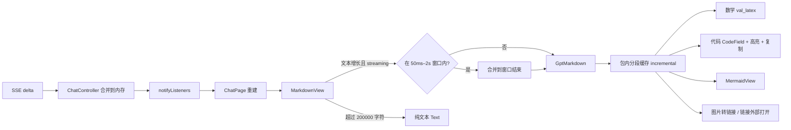

# Markdown / 数学 / Mermaid 渲染规格

本文锁定票 08 的决策，收口票 01、02、03 的调研结论。行为契约以
`~/ZoneCode/chat-demo` 为准；实现位于 `lib/ui/markdown_view.dart`，
验收样例对应 `test/ui/markdown_view_test.dart`。

核查日期：2026-11-18。

## 1. 选型结论

| 能力 | 主选 | 锁定版本 | 备选 | 不选 |
| --- | --- | --- | --- | --- |
| Markdown 解析与流式渲染 | `gpt_markdown` | 1.4.1 | `flutter_markdown_plus` + `flutter_markdown_stream` | `flutter_markdown`（已下架）、`markdown_widget`（停更）、`markdown_forge`、`super_markdown`（不存在） |
| 数学公式 | `val_latex_flutter`（`gpt_markdown` 内置同一引擎） | 0.1.4 | `katex` + `katex_dart` | `flutter_math_fork`（Flutter 3.29+ 构建失败）、`katex_flutter`（停更） |
| Mermaid | `mermaid_flutter` + `mermaid_core` | 0.3.2 / 0.3.2 | WebView + 本地 mermaid.js | `flutter_mermaid`（停更）、`flutter_mermaid_native`（实验性）、`merman`（无 Flutter widget） |
| 代码高亮 | `gpt_markdown` 内置 `val_highlight` + `val_highlight_flutter` | 0.1.1 / 0.1.2（传递依赖） | `re_highlight` | `flutter_highlight`（额外依赖，包内已有同等能力） |
| 链接打开 | `url_launcher` | 6.3.3 | — | — |

用户提供的 Mermaid 包清单经票 03 逐项核实：7 个包名全部存在，问题在能力
被夸大，不在包名；不存在的包不得沿用。

依赖声明用 caret 范围（`^1.4.1` 等），实际解析版本以提交的 `pubspec.lock`
为准。升级任一渲染依赖必须重跑本文第 9 节的验收样例。

## 2. 数学

- 语法：只启用 `\(...\)`（行内）与 `\[...\]`（块级）；`useDollarSignsForLatex:
  false`，避免 `$5`、`$100` 等价格文本被误判为公式。
- 流式：公式随 token 增长直接重排，不关闭渲染等待闭合；半截公式
  （如 `\(\frac{a}{`）不抛异常。
- 保真：与 chat-demo「语义一致」，不追求像素一致。`val_latex_flutter`
  使用 Latin Modern Math 字体，与 chat-demo 的 KaTeX 外观不同。
- 降级链：解析失败时 `val_latex_flutter` 在公式位置显示原文；v1 不实现
  「单公式 WebView + KaTeX」兜底。若后续出现必须像素一致的场景，再按票 02
  的保真降级方案补 WebView。
- 主题：公式随宿主 `TextStyle`/应用深浅色变化，不单独配主题。

## 3. Mermaid

- 通过 `codeBuilder` 接管 `mermaid` 围栏，使用 `MermaidView`。
- 固定高度 320，内置平移、缩放、方向键、复位与全屏弹窗。
- 主题按 `Theme.of(context).brightness` 映射 `MermaidTheme.darkTheme` /
  `defaultTheme`。
- 容错：`keepLastGoodSceneOnError: true`，流式半截语法时保留上一次成功渲染；
  从未成功过时 `errorBuilder` 降级为等宽源码文本，不中断整条回复。
- 不引入 WebView + mermaid.js：约 1.6 MB gzip 资源与每图一个平台视图的
  成本只在纯 Dart 方案不可用时才值得；当前 0.3.x 满足 v1。

## 4. 代码高亮

- 复用 `gpt_markdown` 的 `CodeField`：57 种语言、按围栏语言取语法、无匹配时
  纯文本；语言别名含 `python3`、`shellscript`。
- 主题由包内置的深浅色样式按 `Theme.brightness` 切换，不单独选主题。
- 复制按钮由 `CodeField` 提供，点击后显示反馈。
- 不新增高亮依赖；`val_highlight` 版本跟随 `gpt_markdown`。

## 5. 渲染管线

- 节流：`streaming` 为 true 时，每次渲染从开始更新计时到该帧结束（含等待
  VSync），记录为本次耗时；该帧结束后开启「耗时 × 2」的更新窗口，限制在
  50 ms–2 s。窗口内的 token 合并为一次更新。流结束、切换版本或非流式文本
  立即显示全文。
- AST 缓存：`gpt_markdown` 的增量视图（`incremental` 默认 true）把文档按顶层
  段切分并按源文本缓存；追加只重建尾段，已定稿段复用同一 widget 实例。
- 稳定 key：会话消息列表按消息 id 建 `ValueKey`，避免重建或换序时丢失状态。
- 局部重绘：依赖包内分段缓存；不在外层强行加 `RepaintBoundary`，以避免整段
  回复重复绘制。
- 图片：Markdown 图片不加载网络资源，渲染为可点击的地址链接（与 chat-demo
  的 `ImageAsLink` 一致）。因此没有图片缓存问题，也避免任意 URL 请求。
- 链接：仅打开 `http` / `https`，使用外部浏览器；无协议地址补 `https://`
  （对齐 chat-demo 的 `sanitizeUrl`）；其他 scheme 忽略。`mailto:`、页内锚点
  v1 不特殊处理，与安全取舍一致。

## 6. 降级策略

| 情况 | 行为 |
| --- | --- |
| 数学解析失败 / 半截公式 | 公式位置显示原文，不抛异常 |
| Mermaid 流式半截 | 保留上次成功场景 |
| Mermaid 从未成功解析 | 等宽源码文本 |
| 未知围栏语言 | 纯文本代码块（无高亮） |
| 单个文本块超过 200000 字符 | 跳过 Markdown 解析，按纯文本展示 |
| 链接 scheme 非 http(s) | 不响应 |
| 图片 | 不加载，显示 URL 链接 |

200000 字符上限只针对单块；正常模型输出远低于此值，主要防御导入的超长历史。

## 7. 性能预算

流式渲染的目标（参考设备 iPhone 13 / Pixel 6，尚未实测）：

- 更新频率：不低于 50 ms 一次，不高于每 2 s 一次；20 次/秒以内。
- 单次 Markdown 重建主线程耗时 ≤ 16.7 ms，视频级 60 fps 不出现持续掉帧。
- 已定稿段不重新解析、不重新布局。
- 200 条消息、单条约 500 字的会话滚动保持流畅。

未实测项登记在 `map.md` 的未决列表中，真机基准后回填。

## 8. 交互

- 整块文本在 `SelectionArea` 内，支持选区复制。
- 代码块复制由 `CodeField` 提供，带成功反馈。
- 链接与图片地址经 `url_launcher` 在外部应用打开。
- Mermaid 支持平移、缩放、复位与全屏。

## 9. 验收样例

可执行样例见 `test/ui/markdown_view_test.dart`：

| 样例 | 期望 |
| --- | --- |
| `# 标题`、`**粗体**` | 渲染为格式文本，无 Markdown 标记残留 |
| `\(x^2 + y^2\)` | 行内公式 |
| `\[\frac{a}{b}\]` | 块级公式 |
| `It costs $5 and \(x\) is maths` | `$5` 保留原文，`\(x\)` 渲染为公式 |
| `half \(\frac{a}{` | 不抛异常 |
| 合法 `mermaid` 围栏 | 渲染为交互图 |
| `not a diagram` 的 `mermaid` 围栏 | 降级为源码文本 |
| `dart` 围栏 | 渲染为 `CodeField` |
| `` | 不加载图片，显示可点击地址 |
| `` | 显示为补全后的 `https://example.com/a.png` |
| 200001 字符单块 | 纯文本，不解析 Markdown |
| 流式连续增长 | 窗口内合并更新，流结束立即显示全文 |

## 10. 风险与未验证

- `mermaid_flutter` / `mermaid_core` 仍为 0.3.x，API 可能变化；仓库 main 已到
  0.4.0 未发布。
- `val_latex_flutter` 为 0.1.x、单一厂商，Flutter 包无公开源码仓库；字体内嵌
  约 2.1 MB。
- 性能预算未在本机真机基准上验证；50 ms–2 s 节流区间基于 chat-demo 的
  渲染耗时自适应算法，Flutter 侧用帧构建耗时近似。
- 未实现数学公式的 WebView 像素级兜底。
- 选择与复制在流式更新期间可能被节流窗口短暂打断；窗口最长 2 s。
