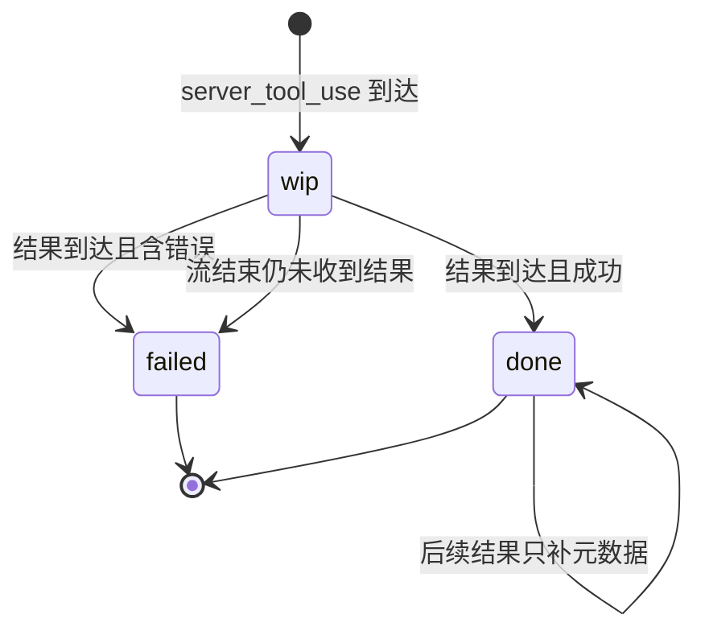

# 联网搜索、阅读链接与引用角标

票：`12-web-search-links`。本文是规格的 `search.md` 章节草案，决策已收敛，可直接转实现。

- 行为来源：`https://github.com/deepseek-ai/chat-demo`（下文标注文件与行号）。
- 关联：工具声明与历史回传已由 [`api.md`](api.md) 锁定；渲染管线见 [`markdown.md`](markdown.md)；块结构见 [`data-model.md`](data-model.md)；原型方向见票 09。
- 与其他票的交接：视觉细节（角标、胶囊、抽屉、时间线图标与间距）→ 票 10；英文文案与 i18n key → 票 18；本章节并入总规格 → 票 11。

## 1. 决策摘要

| 主题 | 决策 |
| --- | --- |
| 开关 | 「深度思考」与「智能搜索」是两个独立开关，持久化到 `shared_preferences`，默认关闭；同时开启即深度思考搜索，没有第三个开关 |
| 快照 | 回复创建时快照 `thinking` / `search`；进行中的回复不受后续切换影响；续写沿用原快照 |
| 视图 | 搜索步骤不落库，由持久化块纯函数推导 `ReplyView` |
| 角标 | 灰色数字小标签，点击外部浏览器打开来源 URL；移动端不做悬停预览 |
| 来源列表 | 回复完成后显示「N 个网页」胶囊；点击由下向上弹出抽屉，展示全部去重网页 |
| 重试 | 工具失败不提供单独重试；失败随回复保留，用户只能重新生成 |
| 图片搜索 | 只影响进度与结果文案；`image_url` 保存但不渲染 |
| 文案 | 中文按本文基线锁定；英文交票 18 |
| 数据 | 无新表、无新列、无新依赖 |

票 09 原型的「正文下方横向来源卡」由本文的「胶囊 + 底部抽屉」取代，其余原型方向不变。

## 2. 开关与工具声明

- 输入区保留两个描边胶囊开关：深度思考、智能搜索（票 09）。二者可随时切换，只影响之后创建的回复。
- 持久化：写入 `shared_preferences`；首次启动均为 `false`（对齐 `settings.ts:90-99`）。
- 请求工具声明（已由 `api.md` §2 锁定，此处复述）：
  - `deepseek_read_url` 恒声明；
  - `deepseek_web_search` 仅当本轮 `search` 快照为 `true` 时追加。
- `thinking` 快照决定请求体的 `thinking.type`。
- 服务端决定 `server_tool_use.kind`：`search` / `deep_search` / `read_link` / `image_search` / `deep_image_search`。客户端不推断深度搜索，只按服务端返回的 `kind` 渲染。
- 回复记录缺少 `thinking` / `search` 快照时（如旧导入数据），续写按当前设置取值（`store.ts:258-265,708-714,1005`）。

## 3. 视图模型推导

`ReplyView` 由持久化块纯函数推导，不新增持久化状态；每次块变化时重算，可选按回复版本缓存。

```dart
enum ToolStatus { wip, done, failed }

final class Source {
  Source({
    required this.index,
    required this.url,
    required this.title,
    required this.siteName,
    required this.publishedAt,
    required this.snippet,
    required this.siteIcon,
  });
  final int index;            // 从 1 开始
  final String url;
  final String title;         // 缺失时为 url
  final String siteName;      // 可能为空串
  final String? publishedAt;
  final String? snippet;
  final String? siteIcon;
}

final class PageItem {
  final String id;
  final String url;
  final String title;
  final ToolStatus status;
}

final class FindItem {
  final String id;
  final String pattern;
  final ToolStatus status;
}

sealed class ReplyStep {}

final class ThinkingStep extends ReplyStep {
  final String key;                    // thinking-<首个块下标>
  final List<ThinkingBlock> blocks;    // 相邻思考块合并
}

final class PreambleStep extends ReplyStep {
  final String key;                    // text-<首个块下标>
  final String markdown;               // 已插入 [citation:N]
}

final class SearchStep extends ReplyStep {
  final String key;           // 该步骤首次调用的 tool_use id
  final ServerToolKind kind;
  final List<String> queries;
  final List<Source> results;
  ToolStatus status;
}

final class OpenStep extends ReplyStep {
  final List<PageItem> pages;
}

final class FindStep extends ReplyStep {
  final List<FindItem> patterns;
}

final class ReadLinkStep extends ReplyStep {
  final List<PageItem> links;          // 仅 wip 状态进入视图
}

final class ReplyView {
  final List<ReplyStep> steps;
  final ({String markdown, String text})? answer;
  final List<Source> sources;          // 全部可引用来源，按编号
  final List<Source> searchResults;    // 去重后的网页结果，供胶囊与抽屉
}
```

推导步骤（对齐 `view.ts:176-347`）：

1. 先按 `tool_use_id` 收集全部 `web_search_tool_result` / `web_fetch_tool_result`。
2. 预扫描 `server_tool_use` 块，按块顺序登记来源：
   - `kind` 不含 `read_link` 且结果为 `web_search_tool_result` 时，登记每个 `web_search_result`，其中成功项同时进入 `searchResults`；
   - 结果为 `web_fetch_tool_result` 且 `kind == deep_search` 且内容成功时，只登记来源（`url`、`content.title`、`published_at`），不进入 `searchResults`。
3. 主扫描按块顺序构造步骤：
   - `isTemplate` 文本块跳过；
   - 思考块：非空时合并相邻思考块（遇到任意非思考块即断开）；首个思考块出现前先结算待定正文为 `PreambleStep`；
   - 文本块：追加到待定正文；遇到工具块或思考块时结算为 `PreambleStep`（`markdown.trim()` 为空则丢弃）；
   - 工具块：`read_link` 且 `input.url` 与结果 URL 都为空时整块忽略；否则结算待定正文，再按表 3.1 聚合。
4. 末尾剩余待定正文即 `answer`；`text` 为空时为 `null`。
5. `sources = registry.list`；`searchResults` 按发现顺序去重。

「待定正文」是尚未结算的文本块序列；被工具块或思考块隔断时结算为过程性正文步骤（`PreambleStep`），最后剩下的一段成为正文。步骤 key 只用于界面身份：搜索用该步骤首次调用的 `tool_use` id，思考与过程性正文用首个块下标，其余按步骤位置。

### 3.1 工具块聚合

| 动作 | 聚合规则 | 展示 |
| --- | --- | --- |
| `search`（普通 `search` / `image_search`） | 按 `kind` 合并到该 kind 首次出现的位置 | 搜索行 |
| `search`（`deep_search` / `deep_image_search`） | 仅当上一步骤是同 `kind` 的搜索时合并（只合并相邻） | 搜索行 |
| `open_page` | 与紧邻的上一个 `OpenStep` 合并 | 浏览行 |
| `find_in_page` | 与紧邻的上一个 `FindStep` 合并 | 查找行 |
| `read_link` | 与紧邻的上一个 `ReadLinkStep` 合并；仅 `wip` 时进入视图 | 阅读行，结束后隐藏 |

- 页面条目（`open_page` / `find_in_page` / `read_link` 共用）：`url` 取 `input.url`，为空时取抓取成功结果的 `url`；`title` 取抓取成功结果的 `content.title`，为空回退 `url`（`view.ts:307-313`）。
- 合并搜索时，查询词追加、结果按来源对象去重追加；状态用 `mergeStatus` 合并。
- `mergeStatus`：任一步骤 `wip` 则 `wip`；全部 `failed` 则 `failed`；否则 `done`。
- 单次工具状态 `getStatus`（`view.ts:89-102`）：
  - 结果块未到：流式中为 `wip`，流已结束为 `failed`；
  - `web_search_tool_result` 含错误项 → `failed`；成功（含空数组）→ `done`；
  - `web_fetch_tool_result` 内容成功 → `done`，否则 `failed`。

### 3.2 工具事件状态机



- 状态只由块推导，不落库；重放同一条回复得到相同视图。
- 工具结果没有自动重试，也没有单工具重试入口。失败是回复内容的一部分，用户只能「重新生成」。

## 4. 时间线展示

- 拒答（`stop_reason == refusal`）不渲染时间线、正文与网页胶囊；已下发的思考与正文按协议丢弃，工具块保留在数据里但不出现在界面（`api.md` §4.3）。拒答文案本身由票 14 定义并展示。
- 只有开启深度思考时才有可折叠标题；未开启时步骤区始终可见、无标题（`ReplyArea.tsx:74-104`）。
- 标题文案（`view.ts:369-400`）：

| 条件 | 文案 |
| --- | --- |
| 已有正文 | `已思考（用时 N 秒）`；任一块缺用时 → `深度思考` |
| 流已结束且无正文 | `已停止` |
| 流式中，最后一步搜索 `wip` | 图像搜索 → `图像搜索中...`；其余 → `正在搜索` |
| 流式中，最后一步浏览或查找 `wip` | `正在浏览网页` |
| 流式中，最后一步阅读链接 `wip` | `正在阅读` |
| 其他流式中 | `正在思考` |

- 标题每秒刷新一次；搜索查询词多于一条时每 2 s 轮播一条。计时为各思考块用时之和，`Math.round`，最小 1 秒。
- 富状态步骤文案：

| 步骤状态 | 文案 |
| --- | --- |
| 搜索中，有查询词 | `搜索` + 当前查询词（轮播） |
| 搜索中，无查询词 | 图像搜索 → `图像搜索中...`；其余 → `搜索中...` |
| 搜索失败且用户已停止 | `搜索已停止` |
| 搜索失败 | `联网搜索暂不可用` |
| 搜索成功，0 结果 | 深度 → `未搜索到合适内容`；其余 → `未搜索到相关内容` |
| 搜索成功，N 结果 | 深度 → `搜索到 N 个网页`；其余 → `已阅读 N 个网页` |
| 浏览行全部失败 | `浏览页面失败` |
| 浏览行单页失败 | 页名 + tooltip `浏览失败` |
| 浏览行成功 | `浏览 1 个页面` / `浏览 N 个页面` + 前 5 个页面链接；超过 5 个时追加「查看全部」 |
| 查找行全部失败 | `查找失败` |
| 查找单项失败 | 标签 + tooltip `未查找到相关内容` |
| 阅读链接进行中 | `正在阅读` + 各页面链接（页名取抓取标题，缺省为 URL） |

- 查找标签状态：`wip` 不显示图标；`done` 显示对勾；`failed` 显示叉号。
- 搜索成功且 N > 0 时，行内追加前 4 个站点缩略图（`SiteLogo`）。
- 搜索行在非 `wip` 且有结果时可点击，打开网页抽屉（§7）。
- 浏览行「查看全部」同样打开网页抽屉；抽屉是全局列表，不按步骤过滤。
- 思考块与过程性正文使用小号 Markdown；思考内容不渲染链接、不挂引用角标。

## 5. 引用角标

### 5.1 文本拼接与编号

- 每条 `citations_delta` 把 `TextCitation` 追加到当前文本块（`api.md` §4.1）；块结束即引用位置，服务端随后另起新文本块。
- 文本块拼接规则（`view.ts:154-174`）：
  1. 按块顺序累加正文；
  2. 每个块的引用按 URL 去重后登记来源，得到编号集合；
  3. 有引用时先 `trimEnd` 取出正文，紧接其后插入 `[citation:N]`，再补回被去掉的尾部空白；
  4. 无引用时原样追加。
- 编号来自统一来源登记（§6）：搜索结果与 `deep_search` 抓取结果在预扫描中先登记，正文引用在文本拼接时后登记。同一 URL 只编号一次。

### 5.2 渲染

- 渲染层用 `gpt_markdown` 1.4.1 的 `inlinePatterns` 接管角标，正则 `\[citation:(\d+)\]`（已核对该版本支持自定义行内语法，`lib/inline_pattern.dart`）。
- 找到来源：渲染为灰色数字小标签，数字等于 `source.index`；点击经 `url_launcher` 在外部浏览器打开来源 URL，仅放行 `http` / `https`（复用 `markdown_view.dart` 的 `_webUri` / `_openLink`）。
- 找不到来源：整个 token 移除，不留空标签。
- 只有正文与过程性正文挂 `sources`；思考块不挂，`[citation:N]` 按原文显示（与 chat-demo 一致）。
- 流式期间 token 未闭合时按原文显示，闭合后变为角标。
- 代码块与行内代码内不解析角标（`inlinePatterns` 只作用于纯文本 run）。
- 移动端不做悬停预览；长按保留系统文本选择。
- 角标样式（颜色、圆角、内边距、字号）由票 10 定；实现优先 `TextSpan` 以保住选区与换行，确需胶囊内边距再用 `WidgetSpan`。

### 5.3 降级

| 情况 | 行为 |
| --- | --- |
| 编号越界或来源不存在 | 移除 token |
| 单个文本块超过 200000 字符 | 按纯文本显示，角标 token 原样保留（票 08 的降级链） |
| 来源 URL 非 http(s) | 角标可见，点击无效 |

## 6. 来源登记规则

对齐 `view.ts:107-148`。登记来源只有三类：搜索结果、`deep_search` 的网页抓取结果、正文引用。`open_page` / `find_in_page` 的页面与 `read_link` 的抓取结果不进入来源表，没有编号，也不出现在抽屉。

1. 以 URL 为唯一键；首次登记时分配递增编号。
2. 后到的同一 URL 只补空字段，不覆盖已有值：
   - 标题仍等于 URL 占位时可用新标题替换；
   - 站点名仍等于域名兜底时可用服务端 `site_name` 替换；
   - `publishedAt`、`snippet`、`siteIcon` 仅在为空时填充。
3. 字段归一化：文本去首尾空白；站点名兜底为 URL 域名去 `www.`，URL 无法解析时为空串；标题、日期、摘要、图标的取值与降级见字段表。

### 6.1 来源卡片字段表

| 字段 | 来源 | 缺失 / 降级 | 展示 |
| --- | --- | --- | --- |
| `index` | 登记顺序 | — | 角标数字 |
| `url` | 搜索结果 / `deep_search` 抓取结果 / 正文引用 | 必需 | 点击外部打开 |
| `title` | 结果标题 / 抓取结果标题 / 引用标题 | 空则显示 URL | 最多 2 行，超出省略 |
| `siteName` | `site_name` → 域名去 `www.` | 空则省略该段 | 元信息行 |
| `publishedAt` | `page_age` / `published_at` | null 则省略；解析失败原样 | 元信息行，`YYYY/MM/DD` |
| `snippet` | 搜索结果 `snippet` | null 则整行省略 | 最多 2 行，超出省略 |
| `siteIcon` | `site_icon` | 缺失或加载失败 → 链接图标；加载中 → 骨架 | 元信息行左侧小图标 |

- 站点名与日期之间用分隔点；两者都缺失时元信息行只留图标。
- 图标只加载 `http` / `https`；失败静默降级，不弹错误。
- 卡片整体可点击，打开来源 URL。

## 7. 网页胶囊与抽屉

### 7.1 胶囊

- 显示条件：回复流式结束、`stop_reason != refusal`，且 `searchResults` 非空。
- 位置：回复底部、分支切换与操作条之上。
- 形态（按用户截图）：圆角胶囊内叠加最多 4 个站点图标（缺失用链接图标占位），右侧文案 `N 个网页`，`N = searchResults.length`。
- 点击：由下向上弹出网页抽屉。
- 流式期间不显示胶囊；进度行内的缩略图与文案照常实时更新。

### 7.2 抽屉

- 入口：胶囊；非 `wip` 且有结果的搜索行；浏览行超过 5 个页面时的「查看全部」。三者打开同一抽屉，内容一致。与 chat-demo 的有意差异：chat-demo 的这两个行内入口按步骤过滤面板内容，本规格按单一抽屉决策统一为全局去重列表。
- 形态：底部弹层，标题 `搜索结果`，由下向上进入。
- 内容：按来源编号列出全部 `searchResults`，复用来源卡片（§6.1）。
- 交互：列表滚动，不做分页；下拉关闭与点击遮罩关闭。
- 状态：抽屉开关是界面局部状态，不持久化，不跨会话保留。
- 抽屉只列 `searchResults`：仅由正文引用登记的来源，以及 `read_link` 的网页（不登记来源），都不进抽屉；对应角标仍可点击打开。
- 视觉细节（圆角、拖拽把手、标题栏、间距）由票 10 定。

## 8. 历史回传与续写

已由 `api.md` §3.4 / §6 锁定，此处复述搜索相关部分：

- 历史只回传 `kind == read_link` 的 `server_tool_use` 与对应成功的 `web_fetch_tool_result`。
- 成功的 `read_link` 结果必须带非空 `signature`；缺失时调用与结果都丢弃；结果缺失的孤立调用照常回传。
- 搜索结果、搜索工具调用、`deep_search` 的网页抓取结果一律不回传。
- 文本块的 `citations` 不回传。
- 回复含任意工具块时不可续写（`api.md` §6 续写资格第 3 条）；含搜索的回复只能重新生成。

## 9. 失败、停止与重试

- 错误不单独提示，落在对应步骤状态上（文案见 §4）。
- `web_search_tool_result_error`（v1 仅见 `unavailable`）→ 搜索行失败；错误码不展示。
- `web_fetch_tool_result_error` → 浏览 / 查找行失败；`read_link` 失败后行隐藏（只展示进行态）；错误码不展示。
- 流在结果到达前结束：状态 `failed`；若用户主动停止，搜索行显示 `搜索已停止`。
- 工具级无重试按钮，无自动重试；用户通过「重新生成」重发整轮。
- 聊天流本身不自动重试（`api.md` §5）。

## 10. 图片搜索

- `image_search` / `deep_image_search` 只影响文案：
  - 进行中无查询词：`图像搜索中...`；
  - 有查询词：同普通搜索的查询词轮播；
  - 结果文案按深度 / 普通两套，与文字搜索一致。
- `web_search_result.image_url` 解析并保存到块中，但不渲染图片，来源卡片不显示缩略图，抽屉只列文字来源。
- v1 不做图片结果墙，也不加载任意图片 URL。

## 11. 与 Markdown 渲染的衔接

- `MarkdownView` 增加可选 `sources` 参数；传入时注册 `[citation:N]` 行内模式，未传时不注册。
- 正文与过程性正文传入 `sources`；思考块不传。
- 既有节流、`200000` 字符纯文本降级、链接与图片处理规则不变（票 08）。
- `SearchStep.results` 的站点图标加载不属于 Markdown 渲染，不受「图片不加载」规则约束；仅限服务端下发的 `site_icon`，且只接受 `http` / `https`。

## 12. 数据与架构影响

- 无新表、无新列：`server_tool_use`、`web_search_tool_result`、`web_fetch_tool_result` 块已由票 06 以 JSON 存储。
- `ReplyView` 是 `features/chat` 内的纯函数；控制器按回复版本缓存可选，视图不持有可变共享状态。
- 无新增依赖：角标用 `gpt_markdown` 的 `inlinePatterns`，外链用既有 `url_launcher`，抽屉用 `shadcn_ui` 的底部弹层。
- 开关读写沿用设置服务（`shared_preferences`）；`thinking` / `search` 需随回复快照持久化（票 06 字段已在回复模型内）。

## 13. 验收样例

视图推导单元测试：

1. 普通搜索被思考块隔开两次，仍合并到首次出现位置；查询词与结果按序追加。
2. 深度搜索被思考块隔开则产生两个搜索行；相邻同 `kind` 才合并。
3. 状态合并：一个 `wip` + 一个 `done` → `wip`；两个 `failed` → `failed`。
4. `read_link` 进行中显示，结果到达后行消失；原始块保留。
5. 浏览行展示前 5 个页面，超出时追加「查看全部」；查找行按调用顺序追加；连续调用合并。
6. `deep_search` 的网页抓取结果只登记来源，不产生步骤行。
7. 同一 URL 多次出现只编号一次；后到元数据只补空，不覆盖标题。
8. 搜索结果与 `deep_search` 抓取结果始终先于正文引用登记；同一 URL 再次出现沿用原编号。
9. `[citation:N]` 插在块尾、尾部空白之前；同块同 URL 只插一次。
10. 编号越界的 token 被移除；代码内 token 不解析。
11. 搜索结果空数组 → `done` 且文案为「未搜索到相关内容」/「未搜索到合适内容」。
12. 流结束仍无结果 → `failed`；用户停止 → 「搜索已停止」。
13. 拒答回复不渲染时间线、正文与网页胶囊。

界面测试：

1. 两个开关默认关闭，重启后保持；开启后请求体追加 `deepseek_web_search` 且 `thinking.type=enabled`。
2. 回复完成后出现胶囊，计数等于去重网页数；流式中不出现。
3. 点击胶囊、搜索行、「查看全部」都打开同一抽屉；抽屉条目数与胶囊一致。
4. 角标点击打开来源 URL；来源缺失的 token 不显示。
5. 站点图标缺失显示链接图标；标题缺失显示 URL。
6. 浏览行超过 5 个页面才出现「查看全部」；查找标签按状态显示对勾、叉号或无图标；阅读行在读取中显示页名。

历史回传测试（补 `api.md` 清单）：

1. 只回传成功的 `read_link` 调用与结果，`signature` 原样保留。
2. 成功结果缺 `signature` 时调用与结果都丢弃；孤立调用照常回传。
3. 搜索工具与搜索结果、深度搜索抓取结果、`citations` 字段全部不回传。

## 14. 交接

| 事项 | 交接 |
| --- | --- |
| 角标、胶囊、抽屉、时间线的视觉与间距；抽屉圆角与把手 | 票 10 |
| 英文文案与 i18n key 组织（中文本文案为基线） | 票 18 |
| 本章节并入总规格 | 票 11 |
| 拒答时正文与引用一起丢弃（工具块保留） | 已由 `api.md` §4.3 锁定 |
| 站点图标远程加载的隐私与失败率 | v1 接受，与 chat-demo 一致；如需代理再评估 |
