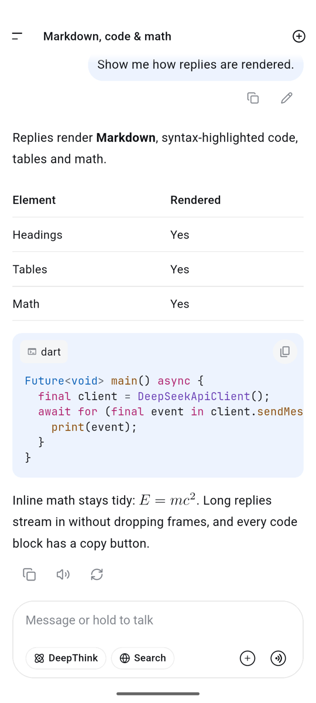
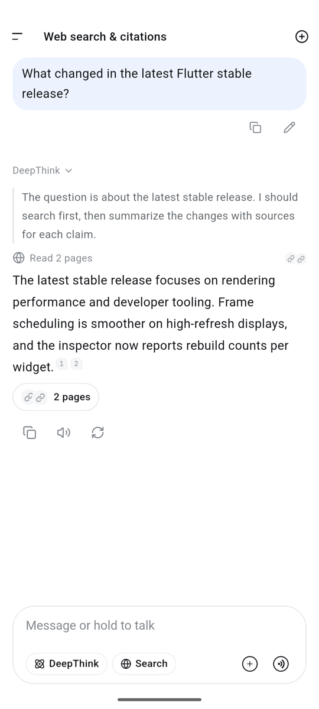
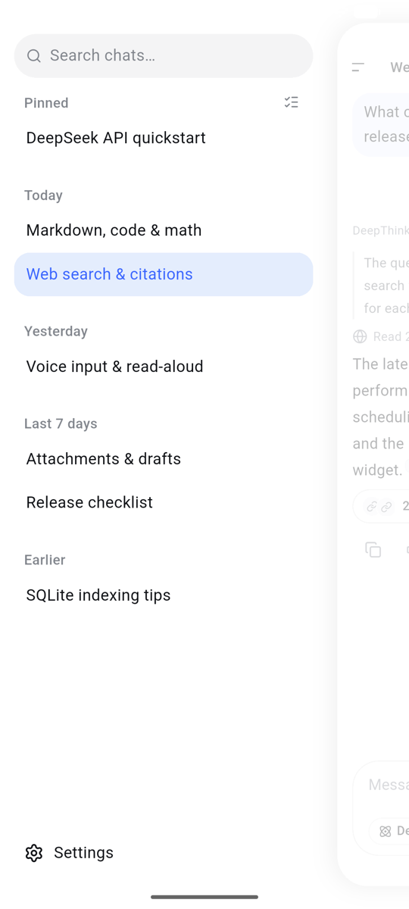
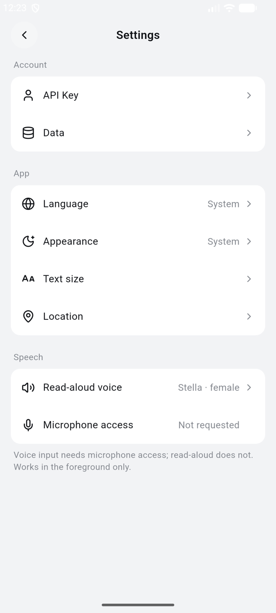

<p align="center">
  
</p>

# SeekChat

[English](README.md) · 中文

Flutter 版 DeepSeek 聊天应用（Android）。v1 固定模型
`deepseek-flash`，API 源默认 `https://api.deepseek.com`，可用
`--dart-define=SEEK_CHAT_API_ORIGIN=<origin>` 覆盖。

## 截图

| 聊天 | 联网搜索与引用 |
| --- | --- |
|  |  |

| 会话抽屉 | 设置 |
| --- | --- |
|  |  |

## 功能

- **聊天**：流式回复、停止、重新生成、编辑提问、续写、多版本分支切换、自动标题
- **渲染**：Markdown、代码高亮与复制、数学公式、Mermaid 图表、链接与图片
- **联网搜索与深度思考**：独立开关、工具时间线、引用角标、网页来源抽屉
- **输入区**：照片与文件附件（图片、PDF、Word、PPT 等，按扩展名白名单）、
  草稿附件、上传状态
- **语音**：按住说话输入、朗读回答、音色选择
- **会话抽屉**：时间分组、搜索、置顶、重命名、多选批量置顶与删除
- **设置**：主题、字体大小、语言（中文 / English）、所在地、朗读音色、API Key
- **数据**：API Key 仅存安全存储；本地 drift/SQLite 持久化；历史 ZIP 导入导出

## 环境要求

- Flutter 3.50.0（与发版工作流一致）
- Dart SDK `^3.14.0`

## 快速开始

```bash
flutter pub get
flutter run
```

启动后进入设置填入 API Key。Debug 构建会自动写入 Markdown 与历史样本；
`--dart-define=SEEK_CHAT_STRESS_SEED=true` 额外写入 1000 会话压测数据。
写入上方截图所用的英文样本：在全新安装上运行
`flutter run --dart-define=SEEK_CHAT_SCREENSHOT_SEED=true`。

## 开发命令

```bash
dart run build_runner build --delete-conflicting-outputs   # 改 drift 表后重新生成
flutter gen-l10n                                           # 改 ARB 后重新生成
flutter analyze
flutter test                                               # 全量
flutter test test/shared/api/sse_parser_test.dart          # 单文件
```

生成物（`database.g.dart`、`lib/l10n/generated/`）入库，不在 `.gitignore`。

## 构建 Android APK

```bash
./tool/build_android_apk.sh
# 产物：build/app/outputs/flutter-apk/SeekChat-{arm64-v8a,armeabi-v7a,x86_64}-release.apk
```

release 需要 `android/key.properties` 与正式 keystore，缺失时立即失败。

## 发版

在 `main` 上打 `v*` tag 触发 GitHub Actions：校验版本、签名构建、创建 draft
Release。本地预检：

```bash
./tool/ci/check_release_version.sh v1.1.0
```

## 本地检查与钩子

```bash
./tool/ci/local_checks.sh        # 生成物漂移 + analyze + test
brew install lefthook            # 每台机器一次
./tool/ci/install_git_hooks.sh   # 安装 pre-push 钩子
```

## 项目结构

- 分层：`lib/main.dart → lib/app → features → shared`，只有被两个以上功能复用的代码进 `shared/`
- 功能目录：`features/chat`（含 `chat/speech`）、`sessions`、`history`、`settings`
- 状态管理：`flutter_riverpod`，手写 Provider
- 数据：drift 四表 `sessions` / `messages` / `attachments` / `message_attachments`
- 路由：`go_router`

## 文档

- [已实现功能的行为规格](docs/features/README.md)（权威）
- [领域术语](GLOSSARY.md)
- [架构决策记录](docs/adr/)
- 未实现与进行中的决策记录在本地 `.scratch/<feature>/`（不入库）

## 许可证

见 [LICENSE](LICENSE)。
