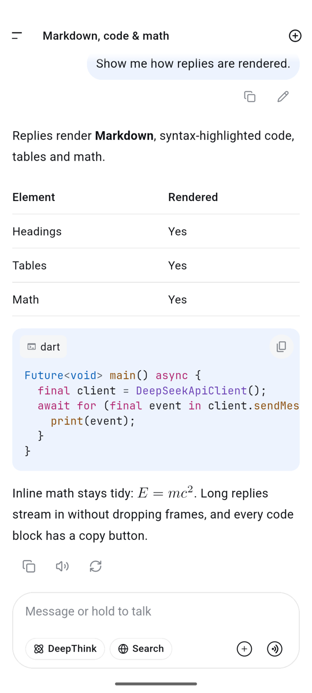
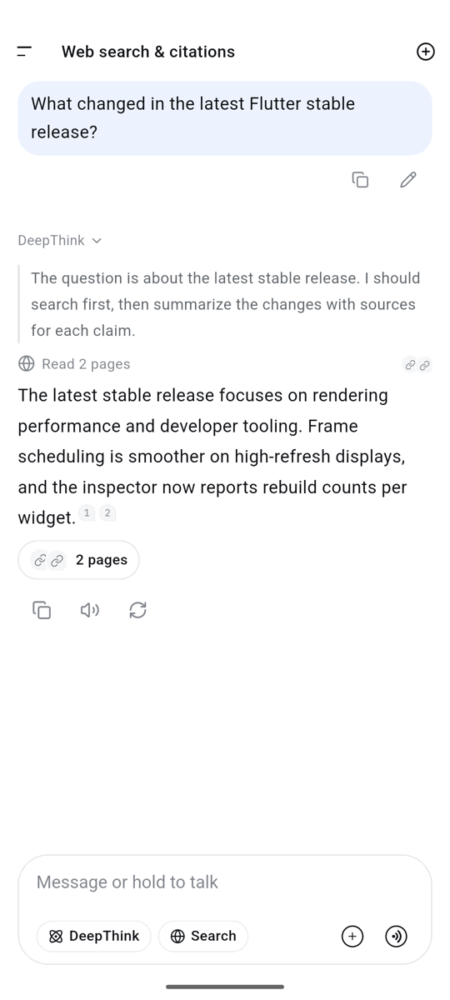
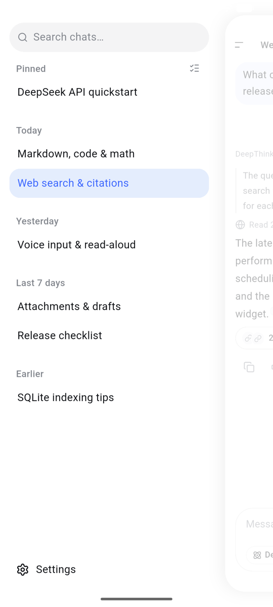
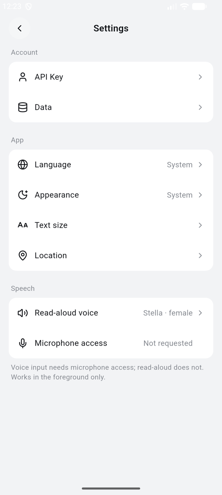

<p align="center">
  
</p>

# SeekChat

English · [中文](README-ZH.md)

A Flutter DeepSeek chat client for Android. v1 uses the fixed model
`deepseek-flash`.

## Screenshots

| Chat | Web search & citations |
| --- | --- |
|  |  |

| Session drawer | Settings |
| --- | --- |
|  |  |

## Features

- **Chat**: streaming replies, stop, regenerate, edit prompt, continue, branch
  switching across versions, auto titles
- **Rendering**: Markdown, syntax-highlighted code with copy, math, Mermaid
  diagrams, links and images
- **Web search & deep thinking**: independent toggles, tool timeline, citation
  badges, source drawer
- **Input**: photo and file attachments (images, PDF, Word, PPT and more, per an
  extension allowlist), draft attachments, upload status
- **Voice**: hold-to-talk input, read replies aloud, voice selection
- **Session drawer**: time groups, search, pin, rename, multi-select batch pin
  and delete
- **Settings**: theme, font size, language (中文 / English), location, voice,
  API key
- **Data**: API key stored only in secure storage; local drift/SQLite
  persistence; ZIP import/export of chat history

## Requirements

- Flutter 3.50.1 (matches the release workflow)
- Dart SDK `^3.14.0`

## Getting started

```bash
flutter pub get
flutter run
```

Open Settings and enter your API key. Debug builds seed Markdown and history
samples; `--dart-define=SEEK_CHAT_STRESS_SEED=true` additionally seeds 1000
sessions for stress testing. To seed the English demo data shown above, run
`flutter run --dart-define=SEEK_CHAT_SCREENSHOT_SEED=true` on a fresh install.

## Development

```bash
dart run build_runner build --delete-conflicting-outputs   # after changing drift tables
flutter gen-l10n                                           # after changing ARB files
flutter analyze
flutter test                                               # full suite
flutter test test/shared/api/sse_parser_test.dart          # single file
```

Generated files (`database.g.dart`, `lib/l10n/generated/`) are committed and not
gitignored.

## Building an Android APK

```bash
./tool/build_android_apk.sh
# Output: build/app/outputs/flutter-apk/SeekChat-{arm64-v8a,armeabi-v7a,x86_64}-release.apk
```

Release builds require `android/key.properties` and a signing keystore; the
script fails fast when they are missing.

## Releasing

Push a `v*` tag on `main` to trigger GitHub Actions: version check, signed
build, draft Release. Local pre-check:

```bash
./tool/ci/check_release_version.sh v1.1.0
```

## Local checks and hooks

```bash
./tool/ci/local_checks.sh        # generated-file drift + analyze + test
brew install lefthook            # once per machine
./tool/ci/install_git_hooks.sh   # installs the pre-push hook
```

## Project layout

- Layers: `lib/main.dart → lib/app → features → shared`; only code shared by
  two or more features goes into `shared/`
- Features: `features/chat` (incl. `chat/speech`), `sessions`, `history`,
  `settings`
- State management: `flutter_riverpod` with hand-written providers
- Data: four drift tables `sessions` / `messages` / `attachments` /
  `message_attachments`
- Routing: `go_router`

## Docs

- [Behavior specs for implemented features](docs/features/README.md)
  (authoritative)
- [Glossary](GLOSSARY.md)
- [Architecture decision records](docs/adr/)
- Unimplemented and in-progress decisions live in `.scratch/<feature>/` (local
  only, gitignored)

## License

See [LICENSE](LICENSE).
